# ERD — Ticketify database

Physical schema after all migrations (table and column names as they exist in PostgreSQL).
Source of truth: [`apps/api/prisma/schema.prisma`](../apps/api/prisma/schema.prisma) + the raw-SQL migration
described in [`apps/api/prisma/README.md`](../apps/api/prisma/README.md).

> This file is checked by `apps/api/test/integration/erd.int-spec.ts`: every table and column of the
> migrated database must appear here, and nothing else. Update it together with the schema.
> Voucher tables arrive in phase 5.

Conventions: `PK` primary key, `FK` foreign key, `UK` unique. All instants are `timestamptz` (UTC), money is `int` (VND), ids are UUIDv7.

```mermaid
erDiagram
    users ||--o{ refresh_tokens : "owns"
    refresh_tokens |o--o| refresh_tokens : "replaced_by"
    users ||--o{ bookings : "places"
    users ||--o{ notifications : "receives"
    users |o--o{ tickets : "checks in"

    movies ||--o{ movie_genres : ""
    genres ||--o{ movie_genres : ""
    movies ||--o{ showtimes : "screened in"
    rooms ||--o{ seats : "contains"
    rooms ||--o{ showtimes : "hosts"

    showtimes ||--o{ showtime_seats : "has"
    seats ||--o{ showtime_seats : "per showtime"
    bookings |o--o{ showtime_seats : "holds / owns"
    showtimes ||--o{ bookings : "for"

    bookings ||--o{ booking_seats : "seat history"
    showtime_seats ||--o{ booking_seats : ""
    bookings ||--o{ booking_combos : "snapshot"
    combos ||--o{ booking_combos : ""
    bookings ||--o{ tickets : "issues"
    showtime_seats ||--o{ tickets : ""
    bookings ||--o{ payments : "attempts"

    users {
        uuid id PK
        text email UK
        text password_hash "argon2id"
        text full_name
        text phone "nullable"
        role role "USER | ADMIN | STAFF"
        timestamptz created_at
        timestamptz updated_at
    }

    refresh_tokens {
        uuid id PK
        uuid user_id FK
        text token_hash UK
        timestamptz expires_at
        timestamptz revoked_at "nullable"
        uuid replaced_by_id FK,UK "nullable, rotation chain"
        timestamptz created_at
    }

    movies {
        uuid id PK
        text title
        text slug UK
        int duration "minutes"
        text poster_key "nullable, object storage key"
        age_rating age_rating "P | K | T13 | T16 | T18 | C"
        date release_date
        movie_status status "COMING_SOON | NOW_SHOWING | ENDED"
        timestamptz created_at
        timestamptz updated_at
    }

    genres {
        uuid id PK
        text name UK
        text slug UK
    }

    movie_genres {
        uuid movie_id PK,FK
        uuid genre_id PK,FK
    }

    rooms {
        uuid id PK
        text name UK
        int rows
        int cols
        timestamptz created_at
        timestamptz updated_at
    }

    seats {
        uuid id PK
        uuid room_id FK "UK(room_id, row, number)"
        text row "A, B, ..."
        int number
        seat_type type "STANDARD | VIP | COUPLE"
        int couple_group "nullable, pairs couple seats"
        boolean is_active
        timestamptz created_at
        timestamptz updated_at
    }

    showtimes {
        uuid id PK
        uuid movie_id FK
        uuid room_id FK "EXCLUDE overlap per room unless CANCELLED"
        timestamptz starts_at
        timestamptz ends_at "CHECK ends_at > starts_at"
        showtime_status status "SCHEDULED | CANCELLED"
        timestamptz created_at
        timestamptz updated_at
    }

    seat_prices {
        uuid id PK
        seat_type seat_type "UK(seat_type, day_type)"
        day_type day_type "WEEKDAY | WEEKEND | HOLIDAY"
        int price
        timestamptz created_at
        timestamptz updated_at
    }

    holidays {
        uuid id PK
        date date UK "cinema-local date"
    }

    combos {
        uuid id PK
        text name
        text description "nullable"
        int price
        text image_key "nullable"
        boolean is_active
        timestamptz created_at
        timestamptz updated_at
    }

    showtime_seats {
        uuid showtime_id PK,FK
        uuid seat_id PK,FK
        showtime_seat_status status "AVAILABLE | HELD | SOLD (CHECKs)"
        uuid booking_id FK "nullable; NULL iff AVAILABLE"
        timestamptz held_until "required when HELD"
        int price "locked at showtime creation"
    }

    bookings {
        uuid id PK
        text code UK
        uuid user_id FK "UK(user_id, idempotency_key)"
        uuid showtime_id FK
        booking_status status "PENDING | CONFIRMED | NEEDS_REVIEW | EXPIRED"
        int subtotal
        int discount
        int total
        timestamptz expires_at "created + HOLD_TTL"
        timestamptz hold_until "expires_at + PAYMENT_GRACE"
        text idempotency_key
        text request_hash
        timestamptz confirmed_at "nullable"
        timestamptz email_sent_at "nullable"
        timestamptz created_at
        timestamptz updated_at
    }

    booking_seats {
        uuid id PK
        uuid booking_id FK "UK(booking_id, seat_id)"
        uuid showtime_id FK
        uuid seat_id FK
        int price
    }

    booking_combos {
        uuid id PK
        uuid booking_id FK
        uuid combo_id FK
        text combo_name "snapshot"
        int unit_price "snapshot"
        int quantity
    }

    tickets {
        uuid id PK
        uuid booking_id FK
        uuid showtime_id FK "UK(showtime_id, seat_id) WHERE status <> VOID"
        uuid seat_id FK
        text code UK
        ticket_status status "ISSUED | CHECKED_IN | VOID"
        timestamptz checked_in_at "nullable"
        uuid checked_in_by_id FK "nullable, staff user"
        timestamptz created_at
        timestamptz updated_at
    }

    payments {
        uuid id PK
        uuid booking_id FK "UK(booking_id) WHERE status = SUCCESS"
        text txn_ref UK "vnp_TxnRef"
        int amount
        payment_status status "PENDING | SUCCESS | FAILED | EXPIRED"
        text vnp_transaction_no UK "nullable"
        text bank_code "nullable"
        text response_code "nullable"
        jsonb raw_payload "nullable"
        timestamptz processed_at "nullable"
        timestamptz created_at
        timestamptz updated_at
    }

    outbox_events {
        uuid id PK
        text type
        text aggregate_id
        jsonb payload
        outbox_status status "index (status, next_retry_at)"
        int attempts
        timestamptz next_retry_at
        timestamptz locked_at "nullable"
        text locked_by "nullable"
        text last_error "nullable"
        timestamptz created_at
    }

    notifications {
        uuid id PK
        uuid user_id FK
        text type
        text title
        text body
        jsonb data "nullable"
        timestamptz read_at "nullable"
        timestamptz created_at
    }
```

## Notes

- `showtime_seats` is the **only** place that decides who holds a seat (PLAN section 4); `bookings.hold_until` mirrors `held_until` for the expiry cron.
- `booking_seats` and `tickets` reference `showtime_seats` through the composite key `(showtime_id, seat_id)`.
- `payments` has one row per payment attempt; `tickets` has one row per seat and is created in the same transaction that confirms the booking.
- `outbox_events` and `notifications` are written by the API and consumed by the worker (phase 4).
