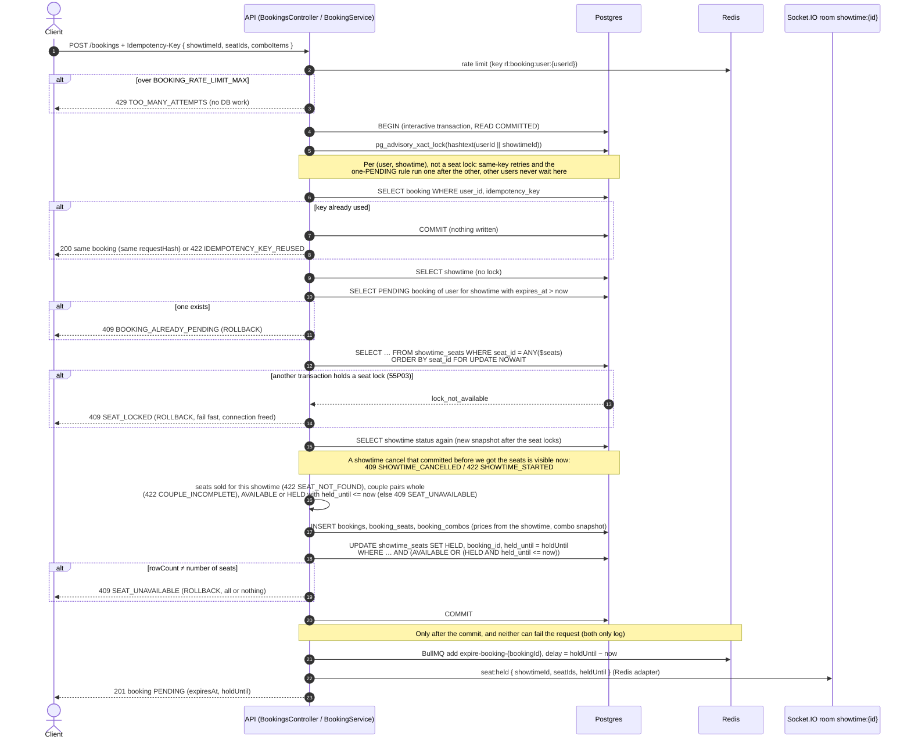
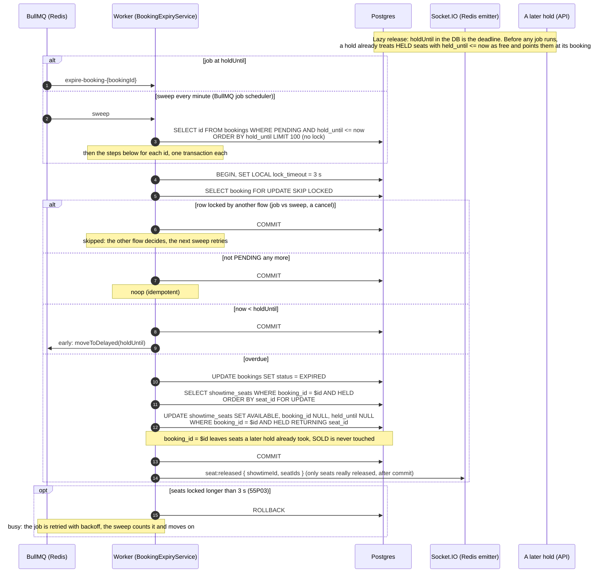
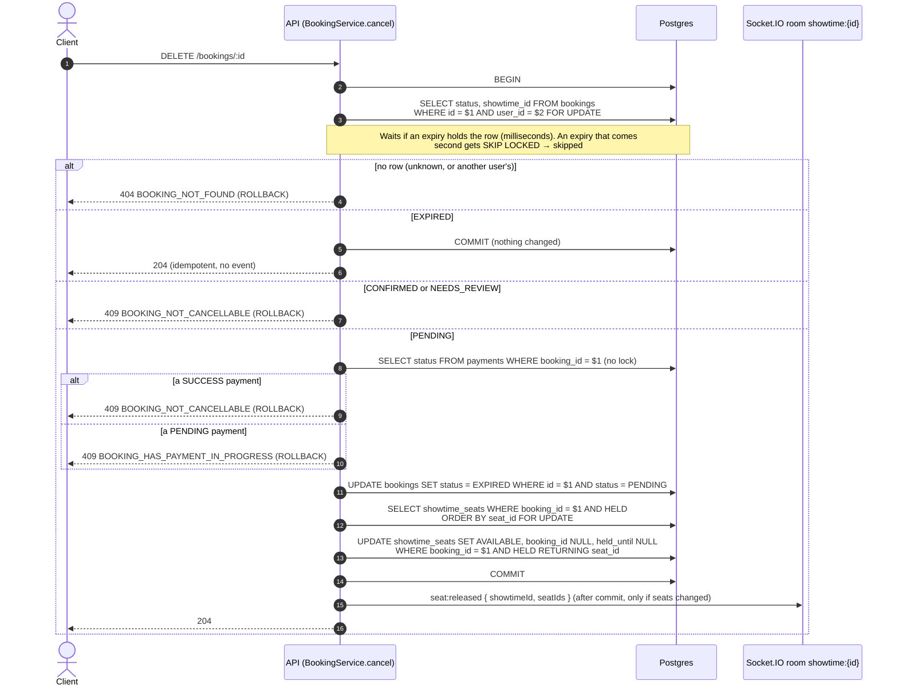

# Sequence diagrams — seat hold, expiry, cancel

How a seat hold lives and ends (PLAN §4, ROADMAP 2.1–2.16). Postgres is the only arbiter of seat
state; Redis carries jobs and realtime events, never seat state.

Lock order shared by every flow that touches seats (no flow waits on another in a cycle):

| Flow | Locks, in order |
|---|---|
| Hold `POST /bookings` | advisory lock (user, showtime) → `showtime_seats` `FOR UPDATE NOWAIT ORDER BY seat_id` |
| Expiry `expireBooking` | `bookings` `FOR UPDATE SKIP LOCKED` → its `HELD` `showtime_seats` `FOR UPDATE ORDER BY seat_id` |
| Cancel `DELETE /bookings/:id` | `bookings` `FOR UPDATE` → (reads `payments`, no lock yet) → its `HELD` `showtime_seats` `FOR UPDATE ORDER BY seat_id` |
| Payment create `POST /payments/vnpay` | `bookings` `FOR KEY SHARE` (compatible with itself, conflicts with the `FOR UPDATE` of cancel and expiry) → inserts `payments` |
| Showtime cancel (admin) | `showtimes` `FOR NO KEY UPDATE` → every `showtime_seats` of it `FOR UPDATE ORDER BY seat_id` |
| Showtime create (admin) | `rooms` `FOR NO KEY UPDATE` → `movies` `FOR SHARE` |

## Hold — `POST /bookings`

## Expiry — `expire-booking` job, per-minute sweep, lazy release

## Cancel — `DELETE /bookings/:id`

A cancelled booking is stored as `EXPIRED`: telling "cancelled by the user" from "ran out of time"
needs a new `BookingStatus` value (ROADMAP "Quyết định chờ"). The delayed `expire-booking` job of
a cancelled booking still runs at `holdUntil` and ends as `noop`.
